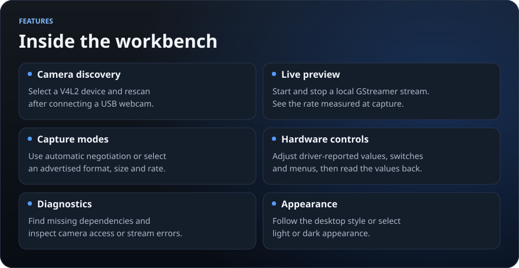
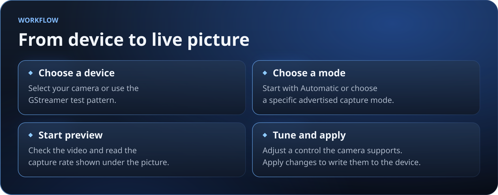
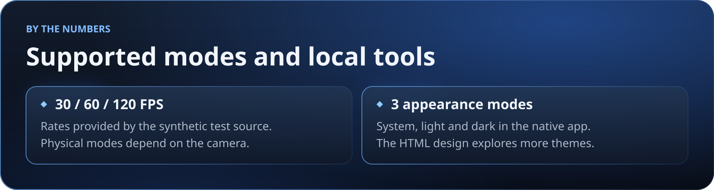

[English](README.md) · **العربية** · [简体中文](README.zh-CN.md) · [繁體中文](README.zh-TW.md) · [Čeština](README.cs.md) · [Français](README.fr.md) · [Deutsch](README.de.md) · [Ελληνικά](README.el.md) · [Bahasa Indonesia](README.id.md) · [Gaeilge](README.ga.md) · [Italiano](README.it.md) · [日本語](README.ja.md) · [한국어](README.ko.md) · [Polski](README.pl.md) · [Română](README.ro.md) · [Русский](README.ru.md) · [Español](README.es.md) · [Українська](README.uk.md) · [اردو](README.ur.md) · [ئۇيغۇرچە](README.ug.md) · [Tiếng Việt](README.vi.md)

<div align="center">


# Open Camera


**منضدة عمل Linux أصلية لكاميرات Video4Linux.**

حدد كاميرا ويب، وشاهد معاينتها المباشرة، واختر وضع الالتقاط، واضبط عناصر التحكم التي يعرضها برنامج تشغيل الكاميرا.


<br>


<a href="#run-on-linux"></a>&nbsp;&nbsp;<a href="#design"></a>&nbsp;&nbsp;<a href="#roadmap"></a>

</div>

<br>



<details>
<summary><b>المزيد عن الميزات</b></summary>

- **الكاميرات.** حدد جهاز V4L2 وأعد المسح بعد توصيل الكاميرا أو فصلها.
- **معاينة حية.** ابدأ وأوقف التدفق المحلي وشاهد معدل الالتقاط المقاس عند المصدر. عند توفره، يقوم التطبيق بطلاء الإطارات باستخدام حوض GStreamer GTK 4. كما أنه يدعم احتياطي نسيج GTK المحدود.
- **أوضاع الالتقاط.** استخدم التفاوض التلقائي أو اختر مجموعة معلن عنها من الدقة وتنسيق البكسل ومعدل الإطارات. تغيير الأوضاع بين جلسات المعاينة.
- **ضوابط الأجهزة.** قم بتحرير عناصر التحكم الرقمية والمفاتيح والقائمة التي أبلغ عنها السائق. يتم إرسال التغييرات إلى السائق أثناء إجرائها.
- **التشخيص والمظهر.** فحص الوصول إلى الجهاز والتبعيات المفقودة وأخطاء المعاينة. توفر الإعدادات النظام والمظهر الفاتح والداكن.

</details>

<br>



<br>


<br>



## بداية سريعة

1. قم بتوصيل كاميرا ويب وحدِّدها **جهاز**. استخدم زر التحديث إذا تم توصيله بعد فتح التطبيق.
2. يختار Open Camera 60 FPS عندما تقوم الكاميرا بالإبلاغ عنه، أو 59.94 FPS عندما يكون هذا هو الوضع الوحيد القريب من 60. يختار **تلقائي** للسماح للسائق بالتفاوض أو اختيار إحدى المجموعات المبلغ عنها.
3. انقر **ابدأ المعاينة**. تقيس قراءات FPS الإطارات القادمة من المصدر. يمكن أن يختلف عن المعدل المطلوب ولا يقيس تحديث الشاشة.
4. اضبط عناصر التحكم التي يعرضها برنامج التشغيل الخاص بك أثناء مشاهدة المعاينة. يؤدي تغيير الدقة أو التنسيق أو معدل الإطارات إلى إعادة تشغيل المعاينة تلقائيًا.

يوفر Open Camera طاولة عمل محلية لتكوين واختبار كاميرا الويب. لا يحتوي الإصدار 0.2.4 على تسجيل أو معالجة تأثيرات أو إخراج كاميرا افتراضية.

<h2 id="roadmap">خريطة الطريق</h2>


| منصة | عمل |
| --- | --- |
| **متاح · v0.2.4** | اختيار الكاميرا، والمعاينة المباشرة، والمصدر FPS، وأدوات التحكم في السائق، والتشخيصات، وثلاث حزم Linux. |
| **التالي · الأجهزة والموثوقية** | تحقق من صحة USB والكاميرات المدمجة، وتحقق من أكثر من 60 وضع FPS المعلن عنه على الأجهزة، واختبر الاسترداد عندما يكون الجهاز مشغولاً أو غير متصل. |
| **المخطط · التقاط سير العمل** | أضف الصور ومقاطع الفيديو والتراكبات والتأثيرات، ثم استكشف الملفات الشخصية ومخرجات الكاميرا الافتراضية. |

وتحدد خارطة الطريق الأولويات دون تواريخ مستهدفة.

<h2 id="run-on-linux">📦 تشغيل على Linux</h2>

تحميل Open Camera **v0.2.4** من [إصدارات GitHub](https://github.com/sailxx/OpenCamera/releases/tag/v0.2.4).

| تحميل | تثبيت أو إطلاق |
| --- | --- |
| [DEB](https://github.com/sailxx/OpenCamera/releases/download/v0.2.4/open-camera_0.2.4_all.deb) | `sudo apt install ./open-camera_0.2.4_all.deb` على أوبونتو 24.04 |
| [RPM](https://github.com/sailxx/OpenCamera/releases/download/v0.2.4/open-camera-0.2.4-1.fc44.noarch.rpm) | `sudo dnf install ./open-camera-0.2.4-1.fc44.noarch.rpm` في فيدورا 44 |
| [AppImage](https://github.com/sailxx/OpenCamera/releases/download/v0.2.4/OpenCamera-0.2.4-x86_64.AppImage) | `chmod +x OpenCamera-0.2.4-x86_64.AppImage` ثم `./OpenCamera-0.2.4-x86_64.AppImage` على x86_64 Linux مع glibc 2.39 أو الأحدث |

ابدأ تثبيت DEB أو RPM من مشغل سطح المكتب أو باستخدام `open-camera`. إذا لم يكن FUSE متاحًا، فقم بتشغيل AppImage باستخدام `./OpenCamera-0.2.4-x86_64.AppImage --appimage-extract-and-run`.

للتحقق من التنزيل، احفظ [SHA256SUMS](https://github.com/sailxx/OpenCamera/releases/download/v0.2.4/SHA256SUMS) بجانب الحزمة وتشغيلها `sha256sum -c --ignore-missing SHA256SUMS` من هذا الدليل.

قام سير عمل الإصدار بتثبيت الحزم الثلاث أو تشغيلها وفحص المعاينة المباشرة باستخدام مصدر اصطناعي. لا يزال التوافق الفعلي لكاميرا الويب بحاجة إلى التحقق من الصحة.

### تشغيل من المصدر

استخدم سطح المكتب Linux مع Python 3.10 + وGTK 4.8 + وlibadwaita 1.4 + وGStreamer 1.20 +. قم بالتشغيل من مجلد المستودع باستخدام نظام Python حتى يتمكن من العثور على روابط PyGObject الخاصة بالتوزيع.

<details open>
<summary><b>أوبونتو 24.04 وأحدث</b></summary>

```sh
sudo apt install python3-gi gir1.2-gtk-4.0 gir1.2-adw-1 \
  gir1.2-gstreamer-1.0 gir1.2-gst-plugins-base-1.0 \
  gstreamer1.0-plugins-base gstreamer1.0-plugins-good v4l-utils
python3 -m open_camera
```

</details>

<details>
<summary><b>فيدورا</b></summary>

```sh
sudo dnf install python3-gobject gtk4 libadwaita gstreamer1 \
  gstreamer1-plugins-base gstreamer1-plugins-good v4l-utils
python3 -m open_camera
```

</details>

<details>
<summary><b>اختبار بدون كاميرا فعلية</b></summary>

```sh
python3 -m open_camera --test-source
```

لاستخدام التثبيت DEB أو RPM `open-camera --test-source`. يختار **نمط اختبار GStreamer**, اختر 30 أو 60 أو 120 FPS بدقة 1280 × 720 ثم انقر **ابدأ المعاينة**. تصف هذه المعدلات مصدر الاختبار. تعتمد أوضاع الجهاز الفعلي على الكاميرا وبرنامج التشغيل.

</details>

### استكشاف الأخطاء وإصلاحها

| أعراض | ما يجب التحقق منه |
| --- | --- |
| الكاميرا مفقودة | أعد توصيله، وقم بتحديث قائمة الأجهزة وتحقق **التشخيص** للمكونات المفقودة أو أذونات الجهاز. |
| فشل بدء المعاينة | أغلق التطبيقات باستخدام الكاميرا، حاول **تلقائي**, ثم تحقق **التشخيص** لخطأ خط الأنابيب. قد تتطلب الأوضاع المشفرة وحدة فك ترميز مثبتة. |
| المصدر FPS أقل من المعدل المختار | تحقق من الأسعار المتاحة بهذا القرار والتنسيق. جرب دقة أقل أو منفذ USB مختلفًا وقارن القياس. |

عند الإبلاغ عن مشكلة، قم بتضمين التوزيع وطراز الكاميرا ووضع الالتقاط المحدد والنص ذي الصلة من **التشخيص**.

<h2 id="design">تصميم</h2>

تظهر اللافتة **النموذج الأولي للمتصفح التفاعلي**. يتضمن إطارات محاكاة وتأثيرات ومخرجات افتراضية بحيث يمكن استكشاف الواجهة بشكل مستقل عن أجهزة الكاميرا. قم بتنزيل [النموذج الأولي HTML القائم بذاته](design/open-camera-interface-options.html) وفتحه في المتصفح. ال [ورقة أنماط الموضوع](design/open-camera-themes.css) متاح بشكل منفصل.

<details>
<summary><b>التطوير والتحقق</b></summary>

| طريق | غاية |
| --- | --- |
| [open_camera/](open_camera/) | واجهة GTK ومعاينة GStreamer وعناصر تحكم V4L2 |
| [الاختبارات/](tests/) | اختبارات تحليل V4L2 والتحقق من صحة التحكم |
| [تصميم/](design/) | النموذج التفاعلي والموضوعات والأيقونات ولقطات الشاشة |
| [الأصول/الملف التمهيدي/](assets/readme/) | بطاقات README وأزرار التنقل |

```sh
python3 -m unittest discover -s tests -v
```

على سطح المكتب Linux، تحقق من البدء والتوقف باستخدام نمط الاختبار عند 30 و60 FPS. باستخدام كاميرا فعلية، تحقق من الأوضاع المعلن عنها والمعدل المقاس والتغييرات التي تطرأ على عناصر تحكم السائق وسلوك قطع الاتصال.

لتجديد لوحات README، قم بتثبيت Pillow في بيئة التطوير الخاصة بك وقم بتشغيلها:

```sh
python3 tools/build_readme_assets.py
```

</details>

## عن المؤلف

<a href="https://github.com/sailxx"></a>

**sailxx** هو منشئ Open Camera و [Tobi](https://github.com/sailxx/Tobi), المشروع الذي ألهم الأسلوب البصري لـ README. مشاريع أخرى متاحة على [الملف الشخصي لـGitHub](https://github.com/sailxx).
