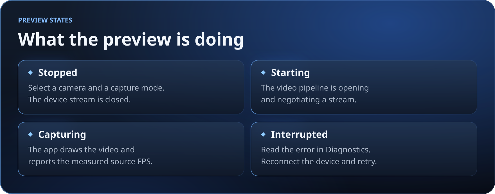

[English](README.md) · [العربية](README.ar.md) · [简体中文](README.zh-CN.md) · [繁體中文](README.zh-TW.md) · [Čeština](README.cs.md) · [Français](README.fr.md) · **Deutsch** · [Ελληνικά](README.el.md) · [Bahasa Indonesia](README.id.md) · [Gaeilge](README.ga.md) · [Italiano](README.it.md) · [日本語](README.ja.md) · [한국어](README.ko.md) · [Polski](README.pl.md) · [Română](README.ro.md) · [Русский](README.ru.md) · [Español](README.es.md) · [Українська](README.uk.md) · [اردو](README.ur.md) · [ئۇيغۇرچە](README.ug.md) · [Tiếng Việt](README.vi.md)

<div align="center">


# Open Camera


**Eine native Linux-Workbench für Video4Linux-Kameras.**

Wählen Sie eine Webcam aus, sehen Sie sich deren Live-Vorschau an, wählen Sie einen Aufnahmemodus und passen Sie die vom Kameratreiber bereitgestellten Steuerelemente an.


<br>


<a href="#run-on-linux"></a>&nbsp; &nbsp;<a href="#design"></a>&nbsp; &nbsp;<a href="#roadmap"></a>

</div>

<br>


<details>
<summary><b>Mehr zu den Funktionen</b></summary>

- **Kameras.** Wählen Sie ein V4L2-Gerät aus und scannen Sie erneut, nachdem Sie eine Kamera angeschlossen oder getrennt haben.
- **Live-Vorschau.** Starten und stoppen Sie einen lokalen Stream und sehen Sie sich die an der Quelle gemessene Erfassungsrate an. Sofern verfügbar, malt die App Rahmen mit der Spüle GStreamer GTK 4. Es unterstützt auch einen begrenzten GTK-Textur-Fallback.
- **Aufnahmemodi.** Nutzen Sie die automatische Aushandlung oder wählen Sie eine angekündigte Kombination aus Auflösung, Pixelformat und Bildrate. Ändern Sie den Modus zwischen den Vorschausitzungen.
- **Hardware-Steuerung.** Bearbeiten Sie die vom Fahrer gemeldeten numerischen, Schalter- und Menüsteuerungen. Änderungen werden an den Treiber gesendet, sobald Sie sie vornehmen.
- **Diagnostik und Aussehen.** Überprüfen Sie den Gerätezugriff, fehlende Abhängigkeiten und Vorschaufehler. Die Einstellungen bieten System, helles und dunkles Erscheinungsbild.

</details>

<br>


<br>



<br>


## Schnellstart

1. Schließen Sie eine Webcam an und wählen Sie sie aus **Gerät**. Verwenden Sie die Schaltfläche „Aktualisieren“, wenn diese nach dem Öffnen der App angeschlossen wurde.
2. Open Camera wählt 60 FPS, wenn die Kamera dies meldet, oder 59.94 FPS, wenn dies der einzige Nahe-60-Modus ist. Wählen **Automatisch** um den Fahrer eine der gemeldeten Kombinationen aushandeln oder auswählen zu lassen.
3. Klicken **Vorschau starten**. Die FPS-Auslesung misst Frames, die von der Quelle kommen. Sie kann von der angeforderten Rate abweichen und misst nicht die Monitoraktualisierung.
4. Passen Sie die Steuerelemente an, die Ihr Fahrer anzeigt, während Sie die Vorschau ansehen. Durch Ändern der Auflösung, des Formats oder der Bildrate wird die Vorschau automatisch neu gestartet.

Open Camera bietet eine lokale Workbench zum Konfigurieren und Testen einer Webcam. Die Version 0.2.4 verfügt über keine Aufnahme, Effektverarbeitung oder virtuelle Kameraausgabe.

<h2 id="roadmap">Roadmap</h2>


| Bühne | Arbeiten |
| --- | --- |
| **Verfügbar · v0.2.4** | Kameraauswahl, Live-Vorschau, Quelle FPS, Treibersteuerung, Diagnose und drei Linux-Pakete. |
| **Weiter · Hardware und Zuverlässigkeit** | Validieren Sie die USB und die integrierten Kameras, überprüfen Sie die angekündigten 60+ FPS-Modi auf der Hardware und testen Sie die Wiederherstellung, wenn ein Gerät ausgelastet oder nicht angeschlossen ist. |
| **Geplant · Capture-Workflow** | Fügen Sie Foto- und Videoaufnahmen, Überlagerungen und Effekte hinzu und erkunden Sie dann Profile und die Ausgabe virtueller Kameras. |

Die Roadmap setzt Prioritäten ohne Zieltermine.

<h2 id="run-on-linux">📦 Laufen Sie auf Linux</h2>

Laden Sie Open Camera herunter **v0.2.4** aus [GitHub-Veröffentlichungen](https://github.com/sailxx/OpenCamera/releases/tag/v0.2.4).

| Herunterladen | Installieren oder starten |
| --- | --- |
| [DEB](https://github.com/sailxx/OpenCamera/releases/download/v0.2.4/open-camera_0.2.4_all.deb) | `sudo apt install ./open-camera_0.2.4_all.deb` auf Ubuntu 24.04 |
| [RPM](https://github.com/sailxx/OpenCamera/releases/download/v0.2.4/open-camera-0.2.4-1.fc44.noarch.rpm) | `sudo dnf install ./open-camera-0.2.4-1.fc44.noarch.rpm` auf Fedora 44 |
| [AppImage](https://github.com/sailxx/OpenCamera/releases/download/v0.2.4/OpenCamera-0.2.4-x86_64.AppImage) | `chmod +x OpenCamera-0.2.4-x86_64.AppImage` Dann `./OpenCamera-0.2.4-x86_64.AppImage` auf x86_64 Linux mit glibc 2.39 oder neuer |

Starten Sie die DEB- oder RPM-Installation über den Desktop-Launcher oder mit `open-camera`. Wenn FUSE nicht verfügbar ist, starten Sie AppImage mit `./OpenCamera-0.2.4-x86_64.AppImage --appimage-extract-and-run`.

Speichern Sie, um den Download zu überprüfen [SHA256SUMS](https://github.com/sailxx/OpenCamera/releases/download/v0.2.4/SHA256SUMS) neben dem Paket und führen Sie es aus `sha256sum -c --ignore-missing SHA256SUMS` aus diesem Verzeichnis.

Der Release-Workflow installierte oder startete alle drei Pakete und überprüfte die Live-Vorschau mithilfe einer synthetischen Quelle. Die physische Webcam-Kompatibilität muss noch überprüft werden.

### Von der Quelle ausführen

Verwenden Sie einen Linux-Desktop mit Python 3.10+, GTK 4.8+, libadwaita 1.4+ und GStreamer 1.20+. Führen Sie es aus dem Repository-Ordner mit dem System-Python aus, damit es die PyGObject-Bindungen der Distribution finden kann.

<details open>
<summary><b>Ubuntu 24.04 und neuer</b></summary>

```sh
sudo apt install python3-gi gir1.2-gtk-4.0 gir1.2-adw-1 \
  gir1.2-gstreamer-1.0 gir1.2-gst-plugins-base-1.0 \
  gstreamer1.0-plugins-base gstreamer1.0-plugins-good v4l-utils
python3 -m open_camera
```

</details>

<details>
<summary><b>Fedora</b></summary>

```sh
sudo dnf install python3-gobject gtk4 libadwaita gstreamer1 \
  gstreamer1-plugins-base gstreamer1-plugins-good v4l-utils
python3 -m open_camera
```

</details>

<details>
<summary><b>Testen Sie ohne physische Kamera</b></summary>

```sh
python3 -m open_camera --test-source
```

Für eine DEB- oder RPM-Installation verwenden `open-camera --test-source`. Wählen **GStreamer-Testmuster**, Wählen Sie 30, 60 oder 120 FPS bei 1280 × 720 und klicken Sie **Vorschau starten**. Diese Raten beschreiben die Testquelle. Die Modi für physische Geräte hängen von der Kamera und dem Treiber ab.

</details>

### Fehlerbehebung

| Symptom | Was zu überprüfen ist |
| --- | --- |
| Die Kamera fehlt | Schließen Sie es erneut an, aktualisieren Sie die Geräteliste und überprüfen Sie **Diagnose** für fehlende Komponenten oder Geräteberechtigungen. |
| Die Vorschau startet nicht | Schließen Sie Apps mit der Kamera, versuchen Sie es **Automatisch**, dann prüfen **Diagnose** für den Pipelinefehler. Für codierte Modi ist möglicherweise ein installierter Decoder erforderlich. |
| Die Quelle FPS liegt unter der gewählten Rate | Überprüfen Sie die verfügbaren Raten bei dieser Auflösung und diesem Format. Versuchen Sie es mit einer niedrigeren Auflösung oder einem anderen USB-Anschluss und vergleichen Sie die Messung. |

Wenn Sie ein Problem melden, geben Sie die Verteilung, das Kameramodell, den ausgewählten Aufnahmemodus und den relevanten Text an **Diagnose**.

<h2 id="design">Design</h2>

Das Banner zeigt die **Interaktiver Browser-Prototyp**. Es umfasst simulierte Bilder, Effekte und virtuelle Ausgaben, sodass die Benutzeroberfläche unabhängig von der Kamerahardware erkundet werden kann. Laden Sie die herunter [eigenständiger HTML-Prototyp](design/open-camera-interface-options.html) und öffnen Sie es in einem Browser. Der [Theme-Stylesheet](design/open-camera-themes.css) ist separat erhältlich.

<details>
<summary><b>Entwicklung und Verifizierung</b></summary>

| Weg | Zweck |
| --- | --- |
| [open_camera/](open_camera/) | GTK-Schnittstelle, GStreamer-Vorschau und V4L2-Steuerelemente |
| [Tests/](tests/) | Tests für V4L2-Parsing und Kontrollvalidierung |
| [Design/](design/) | Interaktiver Prototyp, Themen, Symbol und Screenshots |
| [Assets/Readme/](assets/readme/) | README-Karten und Navigationstasten |

```sh
python3 -m unittest discover -s tests -v
```

Überprüfen Sie auf einem Linux-Desktop Start und Stopp mit dem Testmuster bei 30 und 60 FPS. Überprüfen Sie mit einer physischen Kamera die angekündigten Modi, die gemessene Geschwindigkeit, Änderungen an der Fahrersteuerung und das Verbindungsverhalten.

Um die README-Panels neu zu generieren, installieren Sie Pillow in Ihrer Entwicklungsumgebung und führen Sie es aus:

```sh
python3 tools/build_readme_assets.py
```

</details>

## Über den Autor

<a href="https://github.com/sailxx"></a>

**sailxx** ist der Schöpfer von Open Camera und [Tobi](https://github.com/sailxx/Tobi), das Projekt, das den visuellen Stil dieses README inspirierte. Weitere Projekte finden Sie auf der [GitHub-Profil](https://github.com/sailxx).
