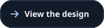

[English](README.md) · [العربية](README.ar.md) · [简体中文](README.zh-CN.md) · [繁體中文](README.zh-TW.md) · [Čeština](README.cs.md) · [Français](README.fr.md) · [Deutsch](README.de.md) · [Ελληνικά](README.el.md) · [Bahasa Indonesia](README.id.md) · [Gaeilge](README.ga.md) · [Italiano](README.it.md) · [日本語](README.ja.md) · [한국어](README.ko.md) · [Polski](README.pl.md) · [Română](README.ro.md) · [Русский](README.ru.md) · **Español** · [Українська](README.uk.md) · [اردو](README.ur.md) · [ئۇيغۇرچە](README.ug.md) · [Tiếng Việt](README.vi.md)

<div align="center">


# Open Camera


**Un banco de trabajo nativo Linux para cámaras Video4Linux.**

Seleccione una cámara web, vea su vista previa en vivo, elija un modo de captura y ajuste los controles expuestos por el controlador de la cámara.


<br>


<a href="#run-on-linux"></a>&nbsp;;<a href="#design"></a>&nbsp;;<a href="#roadmap"></a>

</div>

<br>


<details>
<summary><b>Más sobre las características</b></summary>

- **Cámaras.** Seleccione un dispositivo V4L2 y vuelva a escanear después de conectar o desconectar una cámara.
- **Vista previa en vivo.** Inicie y detenga una transmisión local y vea la tasa de captura medida en la fuente. Cuando esté disponible, la aplicación pinta marcos con el fregadero GStreamer GTK 4. También admite un respaldo de textura GTK limitado.
- **Modos de captura.** Utilice la negociación automática o elija una combinación anunciada de resolución, formato de píxeles y velocidad de fotogramas. Cambie los modos entre sesiones de vista previa.
- **Controles de hardware.** Edite los controles numéricos, de interruptores y de menú informados por el conductor. Los cambios se envían al conductor a medida que los realiza.
- **Diagnóstico y apariencia.** Inspeccione el acceso al dispositivo, las dependencias faltantes y los errores de vista previa. La configuración ofrece sistema, apariencia clara y oscura.

</details>

<br>


<br>


<br>


## Inicio rápido

1. Conecte una cámara web y selecciónela en **Dispositivo**. Utilice el botón de actualización si se conectó después de abrir la aplicación.
2. Open Camera selecciona 60 FPS cuando la cámara lo informa, o 59.94 FPS cuando ese es el único modo cercano a 60. Elegir **Automático** para permitir que el conductor negocie o seleccione una de las combinaciones informadas.
3. Hacer clic **Iniciar vista previa**. La lectura FPS mide los fotogramas que llegan desde la fuente. Puede diferir de la frecuencia solicitada y no mide la actualización del monitor.
4. Ajuste los controles que expone su conductor mientras mira la vista previa. Al cambiar la resolución, el formato o la velocidad de fotogramas, la vista previa se reinicia automáticamente.

Open Camera proporciona un banco de trabajo local para configurar y probar una cámara web. La versión 0.2.4 no tiene grabación, procesamiento de efectos ni salida de cámara virtual.

<h2 id="roadmap">Hoja de ruta</h2>


| Escenario | Trabajar |
| --- | --- |
| **Disponible · v0.2.4** | Selección de cámara, vista previa en vivo, fuente FPS, controles del controlador, diagnóstico y tres paquetes Linux. |
| **Siguiente · Hardware y confiabilidad** | Valide el USB y las cámaras integradas, verifique los más de 60 modos FPS anunciados en el hardware y pruebe la recuperación cuando un dispositivo esté ocupado o desconectado. |
| **Planificado · Captura de flujo de trabajo** | Agregue capturas de fotos y videos, superposiciones y efectos, luego explore perfiles y salidas de cámaras virtuales. |

La hoja de ruta establece prioridades sin fechas límite.

<h2 id="run-on-linux">📦 Ejecutar en Linux</h2>

Descargar Open Camera **v0.2.4** de [Lanzamientos de GitHub](https://github.com/sailxx/OpenCamera/releases/tag/v0.2.4).

| Descargar | Instalar o iniciar |
| --- | --- |
| [DEB](https://github.com/sailxx/OpenCamera/releases/download/v0.2.4/open-camera_0.2.4_all.deb) | `sudo apt install ./open-camera_0.2.4_all.deb` en Ubuntu 24.04 |
| [RPM](https://github.com/sailxx/OpenCamera/releases/download/v0.2.4/open-camera-0.2.4-1.fc44.noarch.rpm) | `sudo dnf install ./open-camera-0.2.4-1.fc44.noarch.rpm` en Fedora 44 |
| [AppImage](https://github.com/sailxx/OpenCamera/releases/download/v0.2.4/OpenCamera-0.2.4-x86_64.AppImage) | `chmod +x OpenCamera-0.2.4-x86_64.AppImage` entonces `./OpenCamera-0.2.4-x86_64.AppImage` en x86_64 Linux con glibc 2.39 o más reciente |

Inicie la instalación de DEB o RPM desde el iniciador de escritorio o con `open-camera`. Si FUSE no está disponible, inicie AppImage con `./OpenCamera-0.2.4-x86_64.AppImage --appimage-extract-and-run`.

Para comprobar la descarga, guardar [SHA256SUMS](https://github.com/sailxx/OpenCamera/releases/download/v0.2.4/SHA256SUMS) al lado del paquete y ejecutar `sha256sum -c --ignore-missing SHA256SUMS` de ese directorio.

El flujo de trabajo de lanzamiento instaló o lanzó los tres paquetes y verificó la vista previa en vivo utilizando una fuente sintética. La compatibilidad física de la cámara web aún necesita validación.

### Ejecutar desde la fuente

Utilice un escritorio Linux con Python 3.10+, GTK 4.8+, libadwaita 1.4+ y GStreamer 1.20+. Ejecútelo desde la carpeta del repositorio con el sistema Python para que pueda encontrar los enlaces de PyGObject de la distribución.

<details open>
<summary><b>Ubuntu 24.04 y más reciente</b></summary>

```sh
sudo apt install python3-gi gir1.2-gtk-4.0 gir1.2-adw-1 \
  gir1.2-gstreamer-1.0 gir1.2-gst-plugins-base-1.0 \
  gstreamer1.0-plugins-base gstreamer1.0-plugins-good v4l-utils
python3 -m open_camera
```

</details>

<details>
<summary><b>sombrero</b></summary>

```sh
sudo dnf install python3-gobject gtk4 libadwaita gstreamer1 \
  gstreamer1-plugins-base gstreamer1-plugins-good v4l-utils
python3 -m open_camera
```

</details>

<details>
<summary><b>Prueba sin cámara física</b></summary>

```sh
python3 -m open_camera --test-source
```

Para una instalación DEB o RPM utilice `open-camera --test-source`. Seleccionar **Patrón de prueba GStreamer**, elija 30, 60 o 120 FPS a 1280 × 720 y haga clic **Iniciar vista previa**. Estas tarifas describen la fuente de la prueba. Los modos del dispositivo físico dependen de la cámara y el controlador.

</details>

### Solución de problemas

| Síntoma | Que comprobar |
| --- | --- |
| falta la camara | Vuelva a conectarlo, actualice la lista de dispositivos y verifique **Diagnóstico** para componentes faltantes o permisos de dispositivo. |
| La vista previa no se inicia | Cierra aplicaciones usando la cámara, prueba **Automático**, entonces revisa **Diagnóstico** por el error de tubería. Los modos codificados pueden requerir un decodificador instalado. |
| La fuente FPS está por debajo de la tarifa elegida | Consulta las tarifas disponibles en esa resolución y formato. Pruebe con una resolución más baja o un puerto USB diferente y compare la medida. |

Al informar un problema, incluya la distribución, el modelo de cámara, el modo de captura seleccionado y el texto relevante de **Diagnóstico**.

<h2 id="design">Diseño</h2>

La pancarta muestra el **prototipo de navegador interactivo**. Incluye fotogramas simulados, efectos y salida virtual para que la interfaz pueda explorarse independientemente del hardware de la cámara. Descarga el [prototipo autónomo HTML](design/open-camera-interface-options.html) y ábrelo en un navegador. El [hoja de estilo del tema](design/open-camera-themes.css) está disponible por separado.

<details>
<summary><b>Desarrollo y verificación</b></summary>

| Camino | Objetivo |
| --- | --- |
| [cámara_abierta/](open_camera/) | Interfaz GTK, vista previa de GStreamer y controles V4L2 |
| [pruebas/](tests/) | Pruebas para el análisis y validación del control del V4L2 |
| [diseño/](design/) | Prototipo interactivo, temas, íconos y capturas de pantalla. |
| [activos/léame/](assets/readme/) | Tarjetas README y botones de navegación. |

```sh
python3 -m unittest discover -s tests -v
```

En una computadora de escritorio Linux, verifique el inicio y la parada con el patrón de prueba en 30 y 60 FPS. Con una cámara física, verifique los modos anunciados, la velocidad medida, los cambios en los controles del conductor y el comportamiento de desconexión.

Para regenerar los paneles README, instale Pillow en su entorno de desarrollo y ejecute:

```sh
python3 tools/build_readme_assets.py
```

</details>

## Sobre el autor

<a href="https://github.com/sailxx"></a>

**sailxx** es el creador de Open Camera y [Tobi](https://github.com/sailxx/Tobi), el proyecto que inspiró el estilo visual de este README. Otros proyectos están disponibles en el [Perfil GitHub](https://github.com/sailxx).
