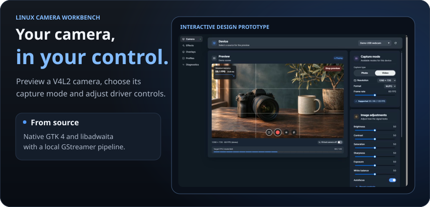

[English](README.md) · [العربية](README.ar.md) · [简体中文](README.zh-CN.md) · [繁體中文](README.zh-TW.md) · [Čeština](README.cs.md) · [Français](README.fr.md) · [Deutsch](README.de.md) · [Ελληνικά](README.el.md) · [Bahasa Indonesia](README.id.md) · **Gaeilge** · [Italiano](README.it.md) · [日本語](README.ja.md) · [한국어](README.ko.md) · [Polski](README.pl.md) · [Română](README.ro.md) · [Русский](README.ru.md) · [Español](README.es.md) · [Українська](README.uk.md) · [اردو](README.ur.md) · [ئۇيغۇرچە](README.ug.md) · [Tiếng Việt](README.vi.md)

<div align="center">


# Open Camera


**Binse oibre dúchais Linux do cheamaraí Video4Linux.**

Roghnaigh ceamara gréasáin, féach ar a réamhamharc beo, roghnaigh modh gabhála agus coigeartaigh na rialuithe a nochtar tiománaí an cheamara.


<br>



<a href="#run-on-linux"></a>&nbsp; &nbsp;<a href="#design"></a>&nbsp; &nbsp;<a href="#roadmap"></a>

</div>

<br>


<details>
<summary><b>Tuilleadh faoi na gnéithe</b></summary>

- **Ceamaraí.** Roghnaigh gléas V4L2 agus athscan tar éis duit ceamara a nascadh nó a dhícheangal.
- **Réamhamharc beo.** Tosaigh agus stop sruth áitiúil agus féach ar an ráta gabhála tomhaiste ag an bhfoinse. Nuair a bhíonn sé ar fáil, péinteann an aip frámaí leis an doirteal GStreamer GTK 4. Tacaíonn sé freisin le cúl-tiontú uigeachta teorantach GTK.
- **Modhanna gabhála.** Bain úsáid as idirbheartaíocht uathoibríoch nó roghnaigh meascán fógartha de thaifeach, formáid picteilín agus ráta fráma. Athraigh modhanna idir seisiúin réamhamhairc.
- **Rialuithe crua-earraí.** Cuir na rialtáin uimhriúla, lasc agus roghchláir a thuairiscigh an tiománaí in eagar. Seoltar athruithe chuig an tiománaí de réir mar a dhéanann tú iad.
- **Diagnóisic agus cuma.** Iniúchadh a dhéanamh ar rochtain gléas, spleáchais ar iarraidh agus earráidí réamhamhairc. Cuireann socruithe cuma chóras, éadrom agus dorcha ar fáil.

</details>

<br>


<br>


<br>


## Tús tapa

1. Ceangail ceamara gréasáin agus roghnaigh isteach é **Gléas**. Bain úsáid as an gcnaipe athnuachan má bhí sé plugáilte isteach tar éis oscailt an app.
2. Roghnaíonn Open Camera 60 FPS nuair a thuairiscíonn an ceamara é, nó 59.94 FPS nuair is é sin an t-aon mhodh gar-60. Roghnaigh **Uathoibríoch** chun ligean don tiománaí ceann de na teaglamaí tuairiscithe a chaibidil nó a roghnú.
3. Cliceáil **Tosaigh réamhamharc**. Tomhaiseann an léamh amach FPS frámaí a thagann ón bhfoinse. Féadfaidh sé a bheith difriúil ón ráta iarrtha agus ní thomhaiseann sé athnuachan monatóireachta.
4. Coigeartaigh na rialuithe a nochtar do thiománaí agus tú ag féachaint ar an réamhamharc. Athsholáthrófar an réamhamharc go huathoibríoch nuair a athraítear an taifeach, an fhormáid nó an ráta fráma.

Soláthraíonn Open Camera binse oibre áitiúil chun ceamara gréasáin a chumrú agus a thástáil. Níl aon taifeadadh, próiseáil éifeachtaí ná aschur ceamara fíorúil ag Leagan 0.2.4.

<h2 id="roadmap">Treochlár</h2>


| Céim | Obair |
| --- | --- |
| **Ar fáil · v0.2.4** | Roghnú ceamara, réamhamharc beo, foinse FPS , rialuithe tiománaithe, diagnóisic agus trí phacáiste Linux. |
| **Ar Aghaidh · Crua-earraí agus iontaofacht** | Bailíochtaigh USB agus ceamaraí ionsuite, seiceáil 60+ modh FPS fógartha ar chrua-earraí, agus déan tástáil ar aisghabháil nuair a bhíonn gléas gnóthach nó díphlugáilte. |
| **Pleanáilte · Gabháil sreabhadh oibre** | Cuir gabháil grianghraf agus físeán, forleagan agus éifeachtaí leis, ansin déan iniúchadh ar phróifílí agus ar aschur ceamara fíorúil. |

Socraíonn an treochlár tosaíochtaí gan spriocdhátaí.

<h2 id="run-on-linux">📦 Rith ar Linux</h2>

Íoslódáil bileog eolais Open Camera **v0.2.4** ó [GitHub Scaoileadh](https://github.com/sailxx/OpenCamera/releases/tag/v0.2.4).

| Íosluchtaigh | Suiteáil nó seoladh |
| --- | --- |
| [DEB](https://github.com/sailxx/OpenCamera/releases/download/v0.2.4/open-camera_0.2.4_all.deb) | `sudo apt install ./open-camera_0.2.4_all.deb` ar Ubuntu 24.04 |
| [RPM](https://github.com/sailxx/OpenCamera/releases/download/v0.2.4/open-camera-0.2.4-1.fc44.noarch.rpm) | `sudo dnf install ./open-camera-0.2.4-1.fc44.noarch.rpm` ar Fedora 44 |
| [AppImage](https://github.com/sailxx/OpenCamera/releases/download/v0.2.4/OpenCamera-0.2.4-x86_64.AppImage) | `chmod +x OpenCamera-0.2.4-x86_64.AppImage` ansin `./OpenCamera-0.2.4-x86_64.AppImage` ar x86_64 Linux le glibc 2.39 nó níos nuaí |

Tosaigh suiteáil DEB nó RPM ón tosaitheoir deisce nó le `open-camera`. Mura bhfuil FUSE ar fáil, seol an AppImage le `./OpenCamera-0.2.4-x86_64.AppImage --appimage-extract-and-run`.

Chun an íoslódáil a sheiceáil, sábháil [SHA256SUMS](https://github.com/sailxx/OpenCamera/releases/download/v0.2.4/SHA256SUMS) in aice leis an bpacáiste agus a reáchtáil `sha256sum -c --ignore-missing SHA256SUMS` ón eolaire sin.

Shuiteáil nó sheol an sreabhadh oibre scaoileadh na trí phacáiste agus seiceáil réamhamharc beo ag baint úsáide as foinse shintéiseach. Ní mór comhoiriúnacht fhisiciúil ceamara gréasáin a bhailíochtú fós.

### Rith ón bhfoinse

Bain úsáid as deasc Linux le Python 3.10 +, GTK 4.8 +, libadwaita 1.4 + agus GStreamer 1.20 +. Rith ón bhfillteán stórtha leis an gcóras Python ionas gur féidir leis ceangail PyGObject an dáileacháin a aimsiú.

<details open>
<summary><b>Ubuntu 24.04 agus níos nuaí</b></summary>

```sh
sudo apt install python3-gi gir1.2-gtk-4.0 gir1.2-adw-1 \
  gir1.2-gstreamer-1.0 gir1.2-gst-plugins-base-1.0 \
  gstreamer1.0-plugins-base gstreamer1.0-plugins-good v4l-utils
python3 -m open_camera
```

</details>

<details>
<summary><b>Fedora</b></summary>

```sh
sudo dnf install python3-gobject gtk4 libadwaita gstreamer1 \
  gstreamer1-plugins-base gstreamer1-plugins-good v4l-utils
python3 -m open_camera
```

</details>

<details>
<summary><b>Tástáil gan ceamara fisiceach</b></summary>

```sh
python3 -m open_camera --test-source
```

Chun suiteáil DEB nó RPM a úsáid `open-camera --test-source`. Roghnaigh **Patrún tástála GStreamer**, roghnaigh 30, 60 nó 120 FPS ag 1280 × 720 agus cliceáil **Tosaigh réamhamharc**. Déanann na rátaí seo cur síos ar an bhfoinse tástála. Braitheann modhanna feiste fisiceach ar an gceamara agus ar an tiománaí.

</details>

### Fabhtcheartú

| Siomptóim | Cad a sheiceáil |
| --- | --- |
| Tá an ceamara ar iarraidh | Déan é a athcheangal, athnuaigh liosta na bhfeistí agus seiceáil **Diagnóisic** le haghaidh comhpháirteanna nó ceadanna gléis atá in easnamh. |
| Teipeann ar an réamhamharc a thosú | Dún aipeanna leis an gceamara, bain triail as **Uathoibríoch**, ansin seiceáil **Diagnóisic** don earráid píblíne. Seans go mbeidh díchódóir suiteáilte de dhíth ar mhodhanna ionchódaithe. |
| Tá an fhoinse FPS faoi bhun an ráta roghnaithe | Seiceáil na rátaí atá ar fáil ag an taifeach sin agus ag an bhformáid sin. Bain triail as taifeach níos ísle nó calafort USB difriúil agus cuir an tomhas i gcomparáid. |

Agus fadhb á tuairisciú agat, cuir san áireamh an dáileadh, múnla an cheamara, an modh gabhála roghnaithe agus an téacs ábhartha ó **Diagnóisic**.

<h2 id="design">Dearadh</h2>

Taispeánann an bhratach na **fhréamhshamhail bhrabhsálaí idirghníomhach**. Áiríonn sé frámaí insamhladh, éifeachtaí agus aschur fíorúil ionas gur féidir an comhéadan a iniúchadh go neamhspleách ar chrua-earraí ceamara. Íoslódáil an [fréamhshamhail HTML féin-chuimsitheach](design/open-camera-interface-options.html) agus é a oscailt i mbrabhsálaí. Tá an [stílbhileog téama](design/open-camera-themes.css) ar fáil ar leithligh.

<details>
<summary><b>Forbairt agus fíorú</b></summary>

| Conair | Cuspóir |
| --- | --- |
| [oscailte_ceamara/](open_camera/) | Comhéadan GTK, réamhamharc GStreamer agus rialuithe V4L2 |
| [tástálacha/](tests/) | Tástálacha do pharsáil agus do bhailíochtú rialaithe V4L2 |
| [dearadh/](design/) | Fréamhshamhail idirghníomhach, téamaí, íocón agus screenshots |
| [sócmhainní/léamh/](assets/readme/) | Cártaí README agus cnaipí loingseoireachta |

```sh
python3 -m unittest discover -s tests -v
```

Ar dheasc Linux, fíoraigh tús agus stop leis an bpatrún tástála ag 30 agus 60 FPS . Le ceamara fisiceach, seiceáil na modhanna fógraithe, an ráta tomhaiste, athruithe ar rialuithe tiománaithe agus iompar dícheangailte.

Chun na painéil README a athghiniúint, suiteáil Pillow i do thimpeallacht forbartha agus reáchtáil:

```sh
python3 tools/build_readme_assets.py
```

</details>

## Maidir leis an údar

<a href="https://github.com/sailxx"></a>

**sailxx** Is é cruthaitheoir Open Camera agus [Tobi](https://github.com/sailxx/Tobi), an tionscadal a spreag stíl amhairc an README seo. Tá tionscadail eile ar fáil ar an [Próifíl GitHub](https://github.com/sailxx).
