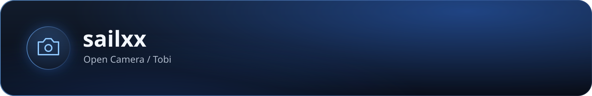

<div align="center">


# Open Camera

[English](README.md) · **Русский** · [Deutsch](README.de.md)

**Утилита для настройки веб-камер в Linux.**

Выберите камеру Video4Linux2, запустите предпросмотр и настройте параметры, которые поддерживает драйвер.

[Скачать](#run-on-linux) · [Быстрый старт](#quick-start) · [Дорожная карта](#roadmap) · [Об авторе](#author)

</div>


## Возможности v0.2.0

- **Выбор камеры.** Список устройств V4L2 обновляется кнопкой рядом с полем выбора камеры.
- **Предпросмотр.** GStreamer показывает локальный видеопоток и измеряет частоту кадров на входе. Для вывода приложение использует GTK 4.
- **Режим захвата.** Приложение выбирает режим автоматически или использует сочетание разрешения, формата и частоты кадров, заявленное драйвером.
- **Настройки устройства.** Можно изменить числовые значения, переключатели и списки, которые предоставляет драйвер. Кнопка **Apply changes** записывает значения и считывает их обратно.
- **Диагностика.** Раздел **Diagnostics** помогает найти недостающие компоненты и ошибки доступа к камере или запуска потока.
- **Внешний вид.** Нативный интерфейс на GTK 4 и libadwaita поддерживает системную, светлую и тёмную темы.

<h2 id="quick-start">Быстрый старт</h2>

1. Подключите веб-камеру и выберите её в поле **Device**. Если подключили устройство после запуска приложения, обновите список.
2. Для первой проверки оставьте режим **Automatic**. Чтобы запросить 60 FPS или выше, выберите режим, где нужная частота доступна с нужным разрешением и форматом.
3. Нажмите **Start preview**. Показатель FPS отражает фактическую частоту кадров на входе. Она может отличаться от выбранной и не связана с частотой обновления монитора.
4. Настройте доступные параметры изображения и нажмите **Apply changes**.

<h2 id="run-on-linux">📦 Установка в Linux</h2>

Пакеты [Open Camera v0.2.0](https://github.com/sailxx/OpenCamera/releases/tag/v0.2.0) доступны в трёх форматах.

| Скачать | Как установить или запустить |
| --- | --- |
| [DEB](https://github.com/sailxx/OpenCamera/releases/download/v0.2.0/open-camera_0.2.0_all.deb) | Ubuntu 24.04 · `sudo apt install ./open-camera_0.2.0_all.deb` |
| [RPM](https://github.com/sailxx/OpenCamera/releases/download/v0.2.0/open-camera-0.2.0-1.fc44.noarch.rpm) | Fedora 44 · `sudo dnf install ./open-camera-0.2.0-1.fc44.noarch.rpm` |
| [AppImage](https://github.com/sailxx/OpenCamera/releases/download/v0.2.0/OpenCamera-0.2.0-x86_64.AppImage) | Linux x86_64 с glibc 2.39+ · `chmod +x OpenCamera-0.2.0-x86_64.AppImage`, затем `./OpenCamera-0.2.0-x86_64.AppImage` |

После установки DEB или RPM откройте Open Camera из меню приложений или командой `open-camera`. Если FUSE недоступен, используйте `./OpenCamera-0.2.0-x86_64.AppImage --appimage-extract-and-run`.

Скачайте [SHA256SUMS](https://github.com/sailxx/OpenCamera/releases/download/v0.2.0/SHA256SUMS) в папку с пакетом и выполните `sha256sum -c --ignore-missing SHA256SUMS`, чтобы сверить контрольную сумму.

Все три пакета прошли автоматическую проверку запуска и предпросмотра с тестовым источником. Совместимость с физическими веб-камерами ещё предстоит проверить.

<details>
<summary><b>Запуск из исходного кода</b></summary>

Требуются Python 3.10+, GTK 4.8+, libadwaita 1.4+ и GStreamer 1.20+. Запускайте команду из папки репозитория системным Python, чтобы он видел PyGObject.

**Ubuntu 24.04**

```sh
sudo apt install python3-gi gir1.2-gtk-4.0 gir1.2-adw-1 \
  gir1.2-gstreamer-1.0 gir1.2-gst-plugins-base-1.0 \
  gstreamer1.0-plugins-base gstreamer1.0-plugins-good v4l-utils
python3 -m open_camera
```

**Fedora**

```sh
sudo dnf install python3-gobject gtk4 libadwaita gstreamer1 \
  gstreamer1-plugins-base gstreamer1-plugins-good v4l-utils
python3 -m open_camera
```

</details>

### Проверка без веб-камеры

Из исходного кода запустите `python3 -m open_camera --test-source`, после установки DEB или RPM используйте `open-camera --test-source`. Выберите **GStreamer test pattern**, установите 30, 60 или 120 FPS при 1280 × 720 и нажмите **Start preview**. Эти режимы доступны тестовому источнику. Частота кадров физической камеры зависит от устройства и драйвера.

### Если что-то не работает

| Симптом | Что проверить |
| --- | --- |
| Камеры нет в списке | Переподключите её, обновите список и проверьте в **Diagnostics** права доступа и наличие компонентов. |
| Предпросмотр не запускается | Закройте другие приложения, использующие камеру, попробуйте **Automatic** и посмотрите ошибку потока в **Diagnostics**. Для форматов со сжатием может потребоваться декодер. |
| Фактический FPS ниже выбранного | Сверьте поддерживаемую частоту при выбранном разрешении и формате. Попробуйте уменьшить разрешение или сменить USB-порт и сравните результат. |

При сообщении об ошибке укажите дистрибутив, модель камеры, режим захвата и текст из **Diagnostics**.

<h2 id="roadmap">Дорожная карта</h2>

| Этап | Задачи |
| --- | --- |
| **Готово · v0.2.0** | Выбор камеры, предпросмотр, измерение FPS, настройки драйвера, диагностика и три формата пакетов. |
| **Далее · Оборудование и стабильность** | Проверить USB- и встроенные камеры, режимы 60+ FPS на реальном оборудовании и восстановление после отключения или занятости устройства. |
| **В планах · Работа с видео** | Снимки и запись видео, оверлеи и эффекты. Затем изучить поддержку профилей и виртуальной камеры. |

Этапы задают приоритеты без привязки к датам.

## Дизайн и разработка

На обложке показан [интерактивный HTML-прототип](design/open-camera-interface-options.html). Скачайте файл и откройте его в браузере, чтобы посмотреть имитацию видео, эффектов и виртуальной камеры. [Стили тем](design/open-camera-themes.css) хранятся отдельно. Запись, эффекты и виртуальный вывод пока отсутствуют в нативной версии 0.2.0.

Код приложения находится в [open_camera/](open_camera/), тесты — в [tests/](tests/), оформление README — в [assets/readme/](assets/readme/). Команда проверки: `python3 -m unittest discover -s tests -v`. Для пересборки плашек установите Pillow в окружение разработки и запустите `python3 tools/build_readme_assets.py`.

<h2 id="author">Об авторе</h2>

<a href="https://github.com/sailxx"></a>

**sailxx** создал Open Camera и [Tobi](https://github.com/sailxx/Tobi), который вдохновил оформление этого README. Другие проекты можно найти в [профиле GitHub](https://github.com/sailxx).
