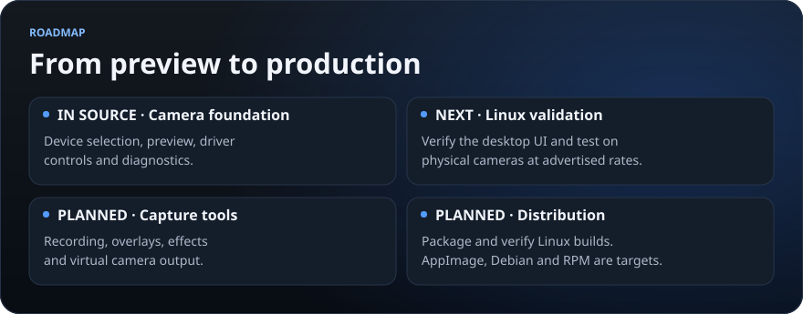

[English](README.md) · [العربية](README.ar.md) · [简体中文](README.zh-CN.md) · [繁體中文](README.zh-TW.md) · [Čeština](README.cs.md) · [Français](README.fr.md) · [Deutsch](README.de.md) · [Ελληνικά](README.el.md) · [Bahasa Indonesia](README.id.md) · [Gaeilge](README.ga.md) · [Italiano](README.it.md) · [日本語](README.ja.md) · [한국어](README.ko.md) · [Polski](README.pl.md) · [Română](README.ro.md) · [Русский](README.ru.md) · [Español](README.es.md) · [Українська](README.uk.md) · **اردو** · [ئۇيغۇرچە](README.ug.md) · [Tiếng Việt](README.vi.md)

<div align="center">


# Open Camera


**Video4Linux کیمروں کے لیے ایک مقامی Linux ورک بینچ۔**

ایک ویب کیم منتخب کریں، اس کا لائیو پیش نظارہ دیکھیں، کیپچر موڈ کا انتخاب کریں اور کیمرہ ڈرائیور کے ذریعے سامنے آنے والے کنٹرولز کو ایڈجسٹ کریں۔


<br>


<a href="#run-on-linux"></a>&nbsp; &nbsp;<a href="#design"></a>&nbsp; &nbsp;<a href="#roadmap"></a>

</div>

<br>


<details>
<summary><b>خصوصیات کے بارے میں مزید</b></summary>

- **کیمرے۔** V4L2 ڈیوائس منتخب کریں اور کیمرہ کنیکٹ کرنے یا منقطع کرنے کے بعد دوبارہ اسکین کریں۔
- **لائیو پیش نظارہ.** ایک مقامی سلسلہ شروع کریں اور روکیں اور ماخذ پر کیپچر کی شرح دیکھیں۔ دستیاب ہونے پر، ایپ GStreamer GTK 4 سنک کے ساتھ فریموں کو پینٹ کرتی ہے۔ یہ ایک پابند GTK ٹیکسچر فال بیک کو بھی سپورٹ کرتا ہے۔
- **کیپچر موڈز۔** خودکار گفت و شنید کا استعمال کریں یا ریزولوشن، پکسل فارمیٹ اور فریم ریٹ کے مشتہر کردہ امتزاج کا انتخاب کریں۔ پیش نظارہ سیشنوں کے درمیان طریقوں کو تبدیل کریں۔
- **ہارڈ ویئر کنٹرولز۔** ڈرائیور کے ذریعہ رپورٹ کردہ عددی، سوئچ اور مینو کنٹرول میں ترمیم کریں۔ تبدیلیاں ڈرائیور کو بھیجی جاتی ہیں جیسے ہی آپ انہیں کرتے ہیں۔
- **تشخیص اور ظاہری شکل۔** ڈیوائس تک رسائی، گمشدہ انحصار اور پیش نظارہ کی خرابیوں کا معائنہ کریں۔ ترتیبات نظام، روشنی اور سیاہ ظہور پیش کرتا ہے.

</details>

<br>


<br>


<br>


## فوری آغاز

1. ایک ویب کیم جوڑیں اور اسے منتخب کریں۔ **ڈیوائس**. ریفریش بٹن کا استعمال کریں اگر یہ ایپ کھولنے کے بعد پلگ ان ہوا تھا۔
2. Open Camera 60 FPS کو منتخب کرتا ہے جب کیمرہ اس کی اطلاع دیتا ہے، یا 59.94 FPS جب صرف 60 کے قریب موڈ ہوتا ہے۔ منتخب کریں۔ **خودکار** ڈرائیور کو گفت و شنید کرنے دیں یا رپورٹ کردہ امتزاج میں سے ایک کو منتخب کریں۔
3. کلک کریں۔ **پیش نظارہ شروع کریں۔**. FPS ریڈ آؤٹ ماخذ سے آنے والے فریموں کی پیمائش کرتا ہے۔ یہ درخواست کردہ شرح سے مختلف ہوسکتا ہے اور مانیٹر ریفریش کی پیمائش نہیں کرتا ہے۔
4. پیش نظارہ دیکھتے ہوئے آپ کے ڈرائیور کے سامنے آنے والے کنٹرولز کو ایڈجسٹ کریں۔ ریزولوشن، فارمیٹ یا فریم ریٹ کو تبدیل کرنے سے پیش نظارہ خود بخود دوبارہ شروع ہو جاتا ہے۔

Open Camera ویب کیم کو ترتیب دینے اور جانچنے کے لیے ایک مقامی ورک بینچ فراہم کرتا ہے۔ ورژن 0.2.4 میں کوئی ریکارڈنگ، اثرات پروسیسنگ یا ورچوئل کیمرہ آؤٹ پٹ نہیں ہے۔

<h2 id="roadmap">روڈ میپ</h2>



| اسٹیج | کام |
| --- | --- |
| **دستیاب · v0.2.4** | کیمرے کا انتخاب، لائیو پیش نظارہ، ذریعہ FPS، ڈرائیور کنٹرول، تشخیص اور تین Linux پیکجز۔ |
| **اگلا · ہارڈ ویئر اور وشوسنییتا** | USB اور بلٹ ان کیمروں کی توثیق کریں، ہارڈ ویئر پر مشتہر 60+ FPS موڈز کو چیک کریں، اور جب کوئی ڈیوائس مصروف یا ان پلگ ہو تو ریکوری کی جانچ کریں۔ |
| **منصوبہ بند · ورک فلو کیپچر کریں۔** | تصویر اور ویڈیو کیپچر، اوورلیز اور اثرات شامل کریں، پھر پروفائلز اور ورچوئل کیمرہ آؤٹ پٹ کو دریافت کریں۔ |

روڈ میپ ہدف کی تاریخوں کے بغیر ترجیحات کا تعین کرتا ہے۔

<h2 id="run-on-linux">📦 Linux پر چلائیں۔</h2>

Open Camera ڈاؤن لوڈ کریں۔ **v0.2.4** سے [GitHub ریلیز](https://github.com/sailxx/OpenCamera/releases/tag/v0.2.4).

| ڈاؤن لوڈ کریں۔ | انسٹال یا لانچ کریں۔ |
| --- | --- |
| [DEB](https://github.com/sailxx/OpenCamera/releases/download/v0.2.4/open-camera_0.2.4_all.deb) | `sudo apt install ./open-camera_0.2.4_all.deb` Ubuntu 24.04 پر |
| [RPM](https://github.com/sailxx/OpenCamera/releases/download/v0.2.4/open-camera-0.2.4-1.fc44.noarch.rpm) | `sudo dnf install ./open-camera-0.2.4-1.fc44.noarch.rpm` فیڈورا 44 پر |
| [AppImage](https://github.com/sailxx/OpenCamera/releases/download/v0.2.4/OpenCamera-0.2.4-x86_64.AppImage) | `chmod +x OpenCamera-0.2.4-x86_64.AppImage` پھر `./OpenCamera-0.2.4-x86_64.AppImage` glibc 2.39 یا جدید تر کے ساتھ x86_64 Linux پر |

ڈیسک ٹاپ لانچر سے یا اس کے ساتھ DEB یا RPM انسٹالیشن شروع کریں۔ `open-camera`. اگر FUSE دستیاب نہیں ہے، AppImage کو اس کے ساتھ لانچ کریں۔ `./OpenCamera-0.2.4-x86_64.AppImage --appimage-extract-and-run`.

ڈاؤن لوڈ چیک کرنے کے لیے، محفوظ کریں۔ [SHA256SUMS](https://github.com/sailxx/OpenCamera/releases/download/v0.2.4/SHA256SUMS) پیکج کے ساتھ اور چلائیں `sha256sum -c --ignore-missing SHA256SUMS` اس ڈائریکٹری سے۔

ریلیز ورک فلو نے تینوں پیکجز کو انسٹال یا لانچ کیا اور مصنوعی ذریعہ کا استعمال کرتے ہوئے لائیو پیش نظارہ چیک کیا۔ جسمانی ویب کیم مطابقت کو ابھی بھی توثیق کی ضرورت ہے۔

### ماخذ سے چلائیں۔

Python 3.10 +، GTK 4.8 +، libadwaita 1.4 + اور GStreamer 1.20 + کے ساتھ Linux ڈیسک ٹاپ استعمال کریں۔ ریپوزٹری فولڈر سے سسٹم Python کے ساتھ چلائیں تاکہ یہ ڈسٹری بیوشن کی PyGObject بائنڈنگز تلاش کر سکے۔

<details open>
<summary><b>Ubuntu 24.04 اور جدید تر</b></summary>

```sh
sudo apt install python3-gi gir1.2-gtk-4.0 gir1.2-adw-1 \
  gir1.2-gstreamer-1.0 gir1.2-gst-plugins-base-1.0 \
  gstreamer1.0-plugins-base gstreamer1.0-plugins-good v4l-utils
python3 -m open_camera
```

</details>

<details>
<summary><b>فیڈورا</b></summary>

```sh
sudo dnf install python3-gobject gtk4 libadwaita gstreamer1 \
  gstreamer1-plugins-base gstreamer1-plugins-good v4l-utils
python3 -m open_camera
```

</details>

<details>
<summary><b>جسمانی کیمرے کے بغیر ٹیسٹ کریں۔</b></summary>

```sh
python3 -m open_camera --test-source
```

DEB یا RPM تنصیب کے لیے استعمال کریں۔ `open-camera --test-source`. منتخب کریں۔ **GStreamer ٹیسٹ پیٹرن**, 1280 × 720 پر 30، 60 یا 120 FPS کا انتخاب کریں اور کلک کریں **پیش نظارہ شروع کریں۔**. یہ شرحیں ٹیسٹ کے ذریعہ کی وضاحت کرتی ہیں۔ فزیکل ڈیوائس موڈز کیمرے اور ڈرائیور پر منحصر ہیں۔

</details>

### خرابی کا سراغ لگانا

| علامت | کیا چیک کرنا ہے۔ |
| --- | --- |
| کیمرہ غائب ہے۔ | اسے دوبارہ جوڑیں، ڈیوائس کی فہرست کو تازہ کریں اور چیک کریں۔ **تشخیص** گمشدہ اجزاء یا ڈیوائس کی اجازتوں کے لیے۔ |
| پیش نظارہ شروع ہونے میں ناکام | کیمرہ استعمال کرتے ہوئے ایپس کو بند کریں، کوشش کریں۔ **خودکار**, پھر چیک کریں **تشخیص** پائپ لائن کی خرابی کے لیے۔ انکوڈ شدہ طریقوں کو انسٹال ڈیکوڈر کی ضرورت ہو سکتی ہے۔ |
| ذریعہ FPS منتخب کردہ شرح سے نیچے ہے۔ | اس ریزولوشن اور فارمیٹ پر دستیاب نرخوں کو چیک کریں۔ کم ریزولوشن یا مختلف USB پورٹ آزمائیں اور پیمائش کا موازنہ کریں۔ |

کسی مسئلے کی اطلاع دیتے وقت، تقسیم، کیمرہ ماڈل، منتخب کیپچر موڈ اور متعلقہ متن شامل کریں۔ **تشخیص**.

<h2 id="design">ڈیزائن</h2>

بینر دکھاتا ہے۔ **انٹرایکٹو براؤزر پروٹو ٹائپ**. اس میں نقلی فریم، اثرات اور ورچوئل آؤٹ پٹ شامل ہے تاکہ کیمرہ ہارڈویئر سے آزادانہ طور پر انٹرفیس کو تلاش کیا جا سکے۔ ڈاؤن لوڈ کریں۔ [خود پر مشتمل HTML پروٹو ٹائپ](design/open-camera-interface-options.html) اور اسے براؤزر میں کھولیں۔ دی [تھیم اسٹائل شیٹ](design/open-camera-themes.css) الگ سے دستیاب ہے۔

<details>
<summary><b>ترقی اور تصدیق</b></summary>

| راستہ | مقصد |
| --- | --- |
| [اوپن_کیمرہ/](open_camera/) | GTK انٹرفیس، GStreamer پیش نظارہ اور V4L2 کنٹرولز |
| [ٹیسٹ/](tests/) | V4L2 تجزیہ اور کنٹرول کی توثیق کے لیے ٹیسٹ |
| [ڈیزائن/](design/) | انٹرایکٹو پروٹو ٹائپ، تھیمز، آئیکن اور اسکرین شاٹس |
| [اثاثے/readme/](assets/readme/) | README کارڈز اور نیویگیشن بٹن |

```sh
python3 -m unittest discover -s tests -v
```

Linux ڈیسک ٹاپ پر، 30 اور 60 FPS پر ٹیسٹ پیٹرن کے ساتھ شروع اور رکنے کی تصدیق کریں۔ فزیکل کیمرہ کے ساتھ، مشتہر طریقوں، پیمائش شدہ شرح، ڈرائیور کے کنٹرول میں تبدیلی اور منقطع رویے کو چیک کریں۔

README پینلز کو دوبارہ تخلیق کرنے کے لیے، اپنے ترقیاتی ماحول میں تکیہ انسٹال کریں اور چلائیں۔:

```sh
python3 tools/build_readme_assets.py
```

</details>

## مصنف کے بارے میں

<a href="https://github.com/sailxx"></a>

**sailxx** Open Camera اور کا خالق ہے۔ [Tobi](https://github.com/sailxx/Tobi), پروجیکٹ جس نے اس README کے بصری انداز کو متاثر کیا۔ دیگر پروجیکٹس پر دستیاب ہیں۔ [GitHub پروفائل](https://github.com/sailxx).
